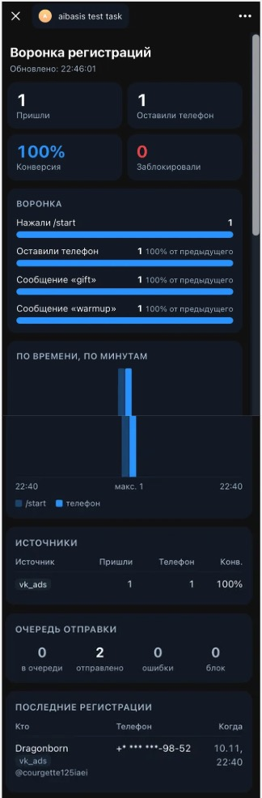

# tg-funnel-dashboard

Telegram-бот регистрации на эфир: `/start` → телефон → два прогревающих сообщения по расписанию. Плюс дашборд в Telegram Mini App: откуда пришли люди и где отвалились.



## Быстрый старт

Нужны [uv](https://docs.astral.sh/uv/) и `cloudflared` (`brew install cloudflared`).

```bash
uv sync
cp .env.example .env      # BOT_TOKEN от @BotFather, ADMIN_IDS — ваш Telegram ID
./scripts/dev.sh          # HTTPS-туннель для Mini App + бот + API + планировщик
```

Дальше в Telegram:
1. `/start` в своём боте → «Отправить номер» → через 10 секунд и через минуту приходят сообщения.
2. `/dashboard` или кнопка меню «Дашборд» → статистика. Её видят только `ADMIN_IDS`.

Без туннеля: `uv run python -m funnel`. Бот работает, дашборда нет, в логе предупреждение.

Проверки: `uv run pytest && uv run mypy src tests && uv run ruff check`.

## Как проверить источники

Метка берётся из deep link и пишется при первом `/start`:

- `https://t.me/<бот>?start=vk_ads`
- `https://t.me/<бот>?start=insta_stories`
- просто `/start` → `direct`

На дашборде в таблице «Источники» видно, сколько пришло и какая конверсия в телефон у каждой метки.

## Устройство

```
Telegram ──long polling──▶ bot.py ─▶ registration.py ─▶ SQLite ◀─ scheduler.py ──▶ Telegram
                                                          ▲
Mini App (static/index.html) ──initData──▶ api.py ─▶ stats.py
```

Всё работает в одном процессе и одном asyncio-цикле: aiogram, uvicorn и планировщик. Тексты и тайминги лежат в `config/funnel.yaml`. Если добавить туда третье сообщение, оно заработает без правки кода, а на дашборде появится новый шаг воронки.

| Файл | Что делает |
|---|---|
| `registration.py` | логика воронки без aiogram, её покрывают тесты |
| `bot.py` | тонкие обработчики aiogram, общий ограничитель скорости на все `send*` |
| `scheduler.py` | отправка отложенных сообщений из базы, token bucket |
| `stats.py`, `api.py` | статистика, `/api/stats`, `/health` |
| `webapp_auth.py` | проверка подписи `initData` |
| `alerts.py` | ошибки уровня ERROR уходят админам в Telegram |

## Решения и почему так

- **Расписание лежит в базе, а не в `asyncio.sleep`.** После перезапуска просроченные сообщения уходят сразу, ничего не теряется. `UNIQUE(tg_id, step_key)` не даёт задвоить сообщение, если контакт пришёл повторно.
- **Ограничение скорости: 25 сообщений в секунду, общее на все отправки.** Лимит Telegram около 30 в секунду. На эфире 2000 человек жмут `/start` одновременно, и ответы бота тоже упираются в этот лимит, поэтому через один token bucket идут ответы, рассылка и алерты. На `RetryAfter` пауза ставится всей отправке, сообщение остаётся в очереди. Пачку планировщик отправляет параллельно, иначе задержка сети ограничила бы темп несколькими сообщениями в секунду.
- **Исходы отправки.** Пользователь заблокировал бота → статус `blocked`, его остальные сообщения не отправляются, на дашборде он в «Заблокировали». Другая ошибка → повтор через 10 секунд, после третьей попытки статус `failed` и алерт.
- **Проверка `initData`** по [документации Telegram](https://core.telegram.org/bots/webapps#validating-data-received-via-the-mini-app): HMAC, `compare_digest`, срок 24 часа. Без подписи `401`, не админ `403`. Адрес дашборда публичный, данные — нет.
- **Телефоны в API только в маске** (`+7 *** ***-12-34`). Полный номер не уходит из базы даже админу.
- **Отсчёт сообщений от момента отправки телефона, а не от `/start`.** Регистрация завершена, дальше начинается прогрев. Кто не оставил телефон, не получает прогрев и виден как отвал на шаге «телефон».
- **Метка источника first-touch.** Повторный `/start` с другой меткой не перезаписывает первую: в зачёт идёт канал, который привёл человека.
- **Наблюдаемость.** Каждый шаг воронки пишется в лог на уровне INFO с `tg_id`. Любая ошибка уровня ERROR приходит админам в Telegram: модуль, текст, `файл:строка`. Одинаковые ошибки не чаще раза в минуту, повторы досчитываются («…и ещё 37 раз»). Сбой отправки алерта никогда не роняет бота. `/health` отдаёт `503`, если база недоступна или планировщик завис.
- **Конфиг проверяется при старте.** Если YAML невалиден, процесс не запускается и показывает путь к полю и причину. Лучше упасть на запуске, чем на эфире.

## Что сделал бы в проде

- Postgres и `SELECT … FOR UPDATE SKIP LOCKED`, чтобы несколько инстансов разбирали очередь без дублей.
- Вебхуки вместо long polling.
- Синтетический health-check: каждые 30 секунд тестовый аккаунт проходит воронку целиком.
- Sentry или аналог рядом с алертами в Telegram.
- VK и MAX через адаптеры поверх `registration.py`: логика воронки от мессенджера не зависит.
- Бэкапы базы.
- Доставка сейчас at-least-once: если процесс упадёт между отправкой и записью статуса, сообщение уйдёт повторно. Для прогрева это приемлемо, для платёжных уведомлений нужна идемпотентность.

## Как делалось с ИИ

Работал в Claude Code. Сначала написал спеку [`docs/spec.md`](docs/spec.md): что делаем, чего не делаем, схема данных, исходы отправки, список тестов. Код писался по спеке. Сгенерированный код не принимался на слово:

- **Типы и тесты:** `mypy --strict`, ruff, 64 теста на логику воронки, планировщик, подпись `initData`, статистику и API.
- **Прогон против поддельного Bot API** до запуска на живом боте: воронка, расписание, алерты, остановка по `Ctrl+C`.
- **Что поймали проверки.** Тест ограничителя скорости завис: из-за погрешности float остаток токена `0.999…` ждал бесконечно малые интервалы. Прогон с поддельным API показал, что блокировка бота пользователем шла как ошибка с алертом, хотя это нормальное событие воронки. Оба места исправлены, на первое есть тест.

## Две работы с ИИ

**[Bany](https://bany.uk)** — приложение для изучения английских слов с интервальными повторениями. Написано с нуля через ИИ. Подключается к Claude как коннектор: слова сохраняются прямо из разговора вместе с предложением, где они встретились; подбираются тексты и подкасты с VOA Learning English под словарь пользователя; записи речи разбираются, и из них получаются задания для разговорного клуба.

**Сервис записи кураторов для онлайн-школы «Академия смысла».** Раньше заявки кураторов на потоки собирал вручную один человек в чате: кто какой поток может вести, подписание NDA, каждый запуск потока шёл со множеством нервов. Сервис автоматизировал это целиком. Начал писать его задолго до ИИ, руками; когда появились ИИ-инструменты, перевёл на них развитие и поддержку. Кураторы работали через Telegram Mini App. Когда Telegram заблокировали, перевёл их на сайт: логика переиспользовалась, поменялся только вход. Об ошибках узнаю первым: сообщение в Telegram с местом в коде. Тот же подход в этом репозитории.

## Если `api.telegram.org` недоступен из сети

Бот ходит в Bot API по HTTPS, а приложение Telegram ходит по своему протоколу. Поэтому бывает, что приложение работает, а бот нет. Два варианта в `.env`:

- `PROXY_URL=socks5://127.0.0.1:1080`, если прокси уже есть;
- `PROXY_SSH=user@host`, если есть сервер с доступом к Telegram. `dev.sh` сам поднимет `ssh -N -D` и выставит `PROXY_URL`. На сервер ничего не ставится, адрес в вывод не печатается.
